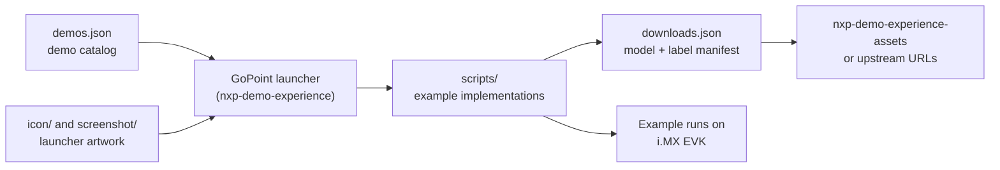
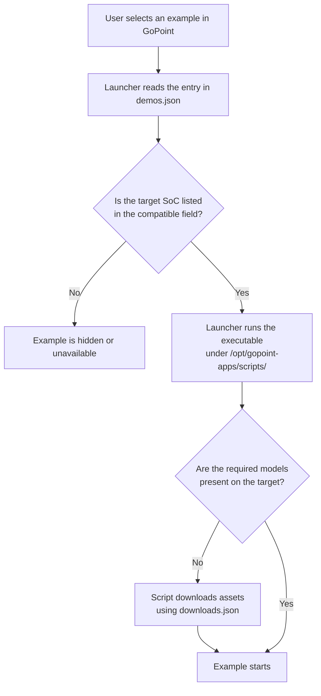
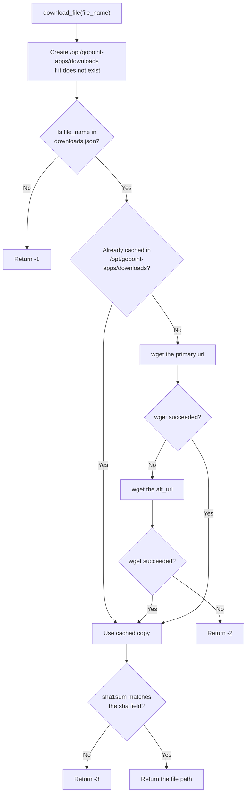
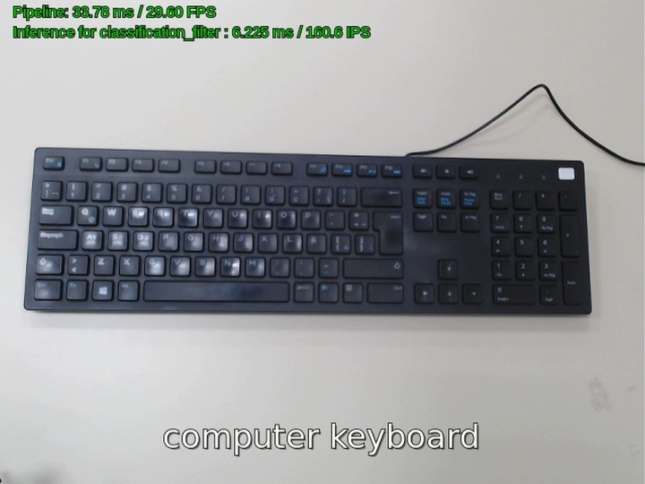
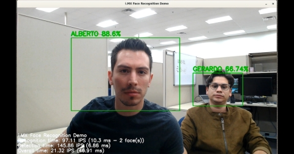

# GoPoint for i.MX Applications Processors - Example Applications Package

[](./LICENSE.txt)
[](https://www.nxp.com/products/processors-and-microcontrollers/arm-processors/i-mx-applications-processors:IMX_HOME)


[](https://github.com/psf/black)

> **NOTE:** The NXP Demo Experience is now GoPoint for i.MX Applications Processors.

## Table of Contents

- [Overview](#overview)
- [Features](#features)
- [Release Information](#release-information)
- [Example Application Categories](#example-application-categories)
- [Supported SoCs per Application](#supported-socs-per-application)
- [Repository Structure](#repository-structure)
- [Architecture](#architecture)
- [Process Flow](#process-flow)
- [Screenshots](#screenshots)
- [Prerequisites](#prerequisites)
- [Getting Started](#getting-started)
- [Installation](#installation)
- [Configuration](#configuration)
- [Building the Project](#building-the-project)
- [Running the Project](#running-the-project)
- [Examples](#examples)
- [Command Reference](#command-reference)
- [Known Issues and Workarounds](#known-issues-and-workarounds)
- [Troubleshooting](#troubleshooting)
- [Related Documentation](#related-documentation)
- [Support](#support)
- [Contributing](#contributing)
- [Licensing](#licensing)

## Overview

NXP's *GoPoint for i.MX Applications Processors* unlocks a world of possibilities. This user-friendly
application launches pre-built examples shipped with the Linux BSP, giving you hands-on experience with
the capabilities of your i.MX SoC. GoPoint targets anyone who wants to showcase the features of NXP SoCs.

The application examples included in GoPoint are easy to run for users of all skill levels, which makes
complex use cases accessible to everyone. Some examples require basic knowledge of Evaluation Kit (EVK)
setup, such as changing Device Tree Blob (DTB) files.

This repository is the example applications package. It contains the demo catalog that GoPoint reads,
the scripts that implement each example, and the icons and screenshots the launcher displays. The GoPoint
launcher application itself lives in a separate repository. See
[Related Documentation](#related-documentation).

## Features

- Demo catalog (`demos.json`) that defines every example, its target compatibility, icon, screenshot, and
  description. The catalog holds 69 entries across 6 categories.
- Download manifest (`downloads.json`) that maps 60 required models, labels, videos, images, and audio
  clips to download URLs with SHA-1 checksums.
- Python and shell implementations for each example application, grouped by domain: 62 Python modules and
  17 shell scripts.
- Icon and screenshot assets rendered by the GoPoint launcher.
- Shared Python helpers in `scripts/utils.py`, including the download-and-verify helper and runtime camera
  capability discovery.
- TUI launcher helper script `scripts/run_tui.sh`.

## Release Information

This README documents the `lf-6.18.37_2.1.0` (2026Q3) release. GoPoint ships as four coordinated
repositories, which must be used together at matching release branches.

| Component | Repository | Release branch |
|---|---|---|
| Launcher application | `nxp-demo-experience` | `lf-6.18.37_2.1.0` |
| Example applications package | `nxp-demo-experience-demos-list` | `lf-6.18.37_2.1.0` |
| Models, media, and patches | `nxp-demo-experience-assets` | `lf-6.18.37_2.1.0` |
| Yocto meta layer | `meta-nxp-demo-experience` | `wrynose-6.18.37-2.1.0` |

The package version recorded in [SW-Content-Register.txt](./SW-Content-Register.txt) is `5.0`.

> **NOTE:** Links in this file that point at the `lf-6.18.37_2.1.0` and `wrynose-6.18.37-2.1.0` branches
> of the public GitHub mirror resolve only after those release branches are published to the mirror.

### Changes in the lf-6.18.37_2.1.0 release

- Asset manifest retargeted: every `downloads.json` URL that resolves to the assets repository now points
  at the `lf-6.18.37_2.1.0` branch, and the SHA-1 checksums were refreshed to match.
- Neutron model naming updated for the assets repository rename. The i.MX 95 models are now published as
  `*_neutron_95.tflite`, and new i.MX 952 variants are published as `*_neutron_952.tflite`. See
  [downloads.json](#downloadsjson) for how the manifest maps these names.
- i.MX 952 support added for the DMS example and for the GLES2 GPU examples.
- ML Benchmark now uses the Neutron-compiled model on the i.MX 95 NPU.
- Camera handling reworked across the ML examples: only video nodes that can actually capture are offered,
  resolution lists are populated from the camera's real capabilities instead of a hard-coded table, and
  the OS08A20 sensor is discovered at run time rather than assumed present.
- Fixed the i.MX 95 OS08A20 I2C device path in the `classification_detection` and `pose_face` examples.
- Fixed intermittent GTK crashes on Run Application, and a Selfie Segmenter crash caused by GTK access
  from a non-main thread.
- Fixed a download-directory crash, duplicate demo IDs, and stale descriptions in the catalog. All 69
  catalog IDs are now unique.
- Corrected NNStreamer backend selection and model path bookkeeping.
- Added the NPU ARA240 example category, and launcher fixes for the `ara2-vision-examples`,
  `llm-edge-studio`, `vlm-edge-studio`, and `smart-device-gateway` packages.
- Moved the TSN example into the `scripts/communication/` folder and updated `demos.json` for the new
  paths and for the i.MX 943 board.

## Example Application Categories

The table below is generated from the catalog in `demos.json`.

| Category | Subcategories | Example count |
|---|---|---:|
| GPU | OpenVG 2D, GLES2 | 27 |
| Machine Learning | NNStreamer, TFLite, OpenCV, Low Power, Snoring Detection | 21 |
| Multimedia | GStreamer, Video Processing, ISP, Audio, Legacy | 13 |
| NPU | ARA240 | 4 |
| Communication | CAN Bus, Wi-Fi, TSN Qbv | 3 |
| Security | ELE | 1 |
| **Total** | | **69** |

Representative examples include Image Classification, Object Detection, Face Detection, ML Benchmark,
Face Recognition, DMS, i.MX Gesture Recognition, Camera using VPU, ISP Control, Audio Record, Audio Play,
Smart Kitchen, E-Bike, EdgeLock Secure Enclave, CAN Car Navigation, Wi-Fi Selector, TSN 802.1Qbv,
Tiger G2D, Cover Flow, Ara2 Vision Examples, LLM Edge Studio, and VLM Edge Studio.

For the authoritative list and per-example instructions, see the
[GoPoint for i.MX Applications Processors User Guide (GPNTUG)](https://www.nxp.com/IMXLINUX).

## Supported SoCs per Application

The table below lists the applications provided directly by this repository and the SoCs each one
supports, as recorded in the `compatible` field of `demos.json` on the `lf-6.18.37_2.1.0` branch.

> **NOTE:** Each chip listed here indicates support for the EVK and the FRDM board, where applicable.

The catalog uses 13 distinct SoC identifiers: `imx7ulp`, `imx8mq`, `imx8mm`, `imx8mn`, `imx8mp`,
`imx8ulp`, `imx8qxpc0mek`, `imx8qmmek`, `imx91`, `imx93`, `imx943`, `imx95`, and `imx952`.

| Demo | Supported SoCs |
|---|---|
| 2Way Video Streaming | i.MX 8MM, i.MX 8MP |
| Audio Record | i.MX 7ULP |
| Audio Play | i.MX 7ULP |
| Camera using VPU | i.MX 8MP |
| CAN Demo | i.MX 8MP, i.MX 93, i.MX 943 |
| DMS | i.MX 8MP, i.MX 93, i.MX 95, i.MX 952 |
| Face Recognition | i.MX 8MP |
| i.MX Gesture Recognition | i.MX 8MP, i.MX 93 |
| i.MX 91 Snoring Detection | i.MX 91 |
| ISP Control | i.MX 8MP |
| LP Baby Cry Detection | i.MX 93 |
| LP KWS Detection | i.MX 93 |
| ML Gateway | i.MX 8MM, i.MX 8MP, i.MX 93, i.MX 95 |
| ML Benchmark | i.MX 8MP, i.MX 93, i.MX 95 |
| Multi Cameras Preview | i.MX 8MP |
| Selfie Segmenter | i.MX 8MP, i.MX 93 |
| TSN 802.1Qbv | i.MX 8MM, i.MX 8MP, i.MX 943 |
| Video Dump | i.MX 8MP |
| Video Test | i.MX 7ULP, i.MX 8MQ, i.MX 8MM, i.MX 8MN, i.MX 8QXP C0 MEK, i.MX 8QM MEK, i.MX 8MP, i.MX 8ULP, i.MX 93, i.MX 943 |
| Multistream Object Detect | i.MX 8MP, i.MX 95 |
| 4K Object Detection | i.MX 8MP, i.MX 95 |

### Applications provided by dependency packages

GoPoint also launches applications that come from other packages. The table below lists those
applications, their source package, and their supported SoCs.

| Demo | Source package | Supported SoCs |
|---|---|---|
| E-Bike VIT | `imx-ebike-vit` | i.MX 8MM, i.MX 8MP, i.MX 93 |
| EdgeLock Secure Enclave | `imx-ele-demo` | i.MX 93 |
| Face Detection | `nxp-nnstreamer-examples` | i.MX 8MP, i.MX 93, i.MX 95 |
| Classification/Detection | `nxp-nnstreamer-examples` | i.MX 8MP, i.MX 93, i.MX 95 |
| Dual Classification | `nxp-nnstreamer-examples` | i.MX 8MP, i.MX 93, i.MX 95 |
| Emotion Detection | `nxp-nnstreamer-examples` | i.MX 8MP, i.MX 93, i.MX 95 |
| Image Classification | `nxp-nnstreamer-examples` | i.MX 8MM, i.MX 8MP, i.MX 8QM MEK, i.MX 93, i.MX 95 |
| Object Detection | `nxp-nnstreamer-examples` | i.MX 8MM, i.MX 8MP, i.MX 8QM MEK, i.MX 93, i.MX 95 |
| Pose/Face | `nxp-nnstreamer-examples` | i.MX 8MP, i.MX 93 |
| Pose Estimation | `nxp-nnstreamer-examples` | i.MX 8MM, i.MX 8MP, i.MX 8QM MEK, i.MX 93, i.MX 95 |
| Semantic Segmentation | `nxp-nnstreamer-examples` | i.MX 8MP, i.MX 93, i.MX 95 |
| i.MX Smart Fitness | `imx-smart-fitness` | i.MX 8MP, i.MX 93 |
| Smart Kitchen | `smart-kitchen` | i.MX 8MM, i.MX 8MP, i.MX 93 |
| Video To Texture Demo | `imx-video-to-texture` | Unsupported this release |
| i.MX Multimedia Player | `imx-voiceplayer` | i.MX 8MM, i.MX 8MP, i.MX 93 |
| Bloom | `gtec-demo-framework` | i.MX 7ULP, i.MX 8MQ, i.MX 8MM, i.MX 8MN, i.MX 8QXP C0 MEK, i.MX 8QM MEK, i.MX 8MP, i.MX 95, i.MX 952 |
| Blur | `gtec-demo-framework` | i.MX 7ULP, i.MX 8MQ, i.MX 8MM, i.MX 8MN, i.MX 8QXP C0 MEK, i.MX 8QM MEK, i.MX 8MP, i.MX 8ULP, i.MX 95, i.MX 952 |
| EightLayerBlend | `gtec-demo-framework` | i.MX 7ULP, i.MX 8MQ, i.MX 8MM, i.MX 8MN, i.MX 8QXP C0 MEK, i.MX 8QM MEK, i.MX 8MP, i.MX 8ULP, i.MX 95, i.MX 952 |
| FractalShader | `gtec-demo-framework` | i.MX 7ULP, i.MX 8MQ, i.MX 8MM, i.MX 8MN, i.MX 8QXP C0 MEK, i.MX 8QM MEK, i.MX 8MP, i.MX 8ULP, i.MX 95, i.MX 952 |
| LineBuilder101 | `gtec-demo-framework` | i.MX 7ULP, i.MX 8MQ, i.MX 8MM, i.MX 8MN, i.MX 8QXP C0 MEK, i.MX 8QM MEK, i.MX 8MP, i.MX 8ULP, i.MX 95, i.MX 952 |
| Mapping | `gtec-demo-framework` | i.MX 7ULP, i.MX 8MQ, i.MX 8MM, i.MX 8MN, i.MX 8QXP C0 MEK, i.MX 8QM MEK, i.MX 8MP, i.MX 8ULP, i.MX 95, i.MX 952 |
| Mapping Refraction | `gtec-demo-framework` | i.MX 7ULP, i.MX 8MQ, i.MX 8MM, i.MX 8MN, i.MX 8QXP C0 MEK, i.MX 8QM MEK, i.MX 8MP, i.MX 8ULP, i.MX 95, i.MX 952 |
| Model Loader | `gtec-demo-framework` | i.MX 7ULP, i.MX 8MQ, i.MX 8MM, i.MX 8MN, i.MX 8QXP C0 MEK, i.MX 8QM MEK, i.MX 8MP, i.MX 8ULP, i.MX 95, i.MX 952 |
| S03_Transform | `gtec-demo-framework` | i.MX 7ULP, i.MX 8MQ, i.MX 8MM, i.MX 8MN, i.MX 8QXP C0 MEK, i.MX 8QM MEK, i.MX 8MP, i.MX 8ULP, i.MX 95, i.MX 952 |
| S04_Projection | `gtec-demo-framework` | i.MX 7ULP, i.MX 8MQ, i.MX 8MM, i.MX 8MN, i.MX 8QXP C0 MEK, i.MX 8QM MEK, i.MX 8MP, i.MX 8ULP, i.MX 95, i.MX 952 |
| S06_Texturing | `gtec-demo-framework` | i.MX 7ULP, i.MX 8MQ, i.MX 8MM, i.MX 8MN, i.MX 8QXP C0 MEK, i.MX 8QM MEK, i.MX 8MP, i.MX 8ULP, i.MX 95, i.MX 952 |
| Cover Flow | `imx-gpu-viv` | i.MX 7ULP, i.MX 8ULP |
| Vivante Launcher | `imx-gpu-viv` | i.MX 7ULP, i.MX 8QXP C0 MEK, i.MX 8QM MEK, i.MX 8MP, i.MX 8ULP |
| Vivante Tutorial | `imx-gpu-viv` | i.MX 7ULP, i.MX 8ULP |
| Video Rotation | `imx-camera-rotation` | i.MX 8MM, i.MX 8MP, i.MX 8ULP |
| Wi-Fi Selector | `imx-wifi-selector` | i.MX 93 |
| Ara2 Vision Examples | `ara2-vision-examples` | i.MX 8MP, i.MX 95 |
| LLM Edge Studio | `llm-edge-studio` | i.MX 8MP, i.MX 95 |
| VLM Edge Studio | `vlm-edge-studio` | i.MX 8MP, i.MX 95 |
| Smart Device Gateway | `smart-device-gateway` | i.MX 8MP, i.MX 95 |

### Application package dependencies

The applications above are pinned by the `meta-nxp-demo-experience` layer, which fetches each one from the
repository listed below. The exact revision used for a given build is set by that layer, so refer to it
rather than to a branch name here.

| Name | Source |
|---|---|
| `nxp-demo-experience-demos-list` | [nxp-imx-support/nxp-demo-experience-demos-list](https://github.com/nxp-imx-support/nxp-demo-experience-demos-list) |
| `imx-ebike-vit` | [nxp-imx-support/imx-ebike-vit](https://github.com/nxp-imx-support/imx-ebike-vit) |
| `imx-ele-demo` | [nxp-imx-support/imx-ele-demo](https://github.com/nxp-imx-support/imx-ele-demo) |
| `nxp-nnstreamer-examples` | [nxp-imx/nxp-nnstreamer-examples](https://github.com/nxp-imx/nxp-nnstreamer-examples) |
| `imx-smart-fitness` | [nxp-imx-support/imx-smart-fitness](https://github.com/nxp-imx-support/imx-smart-fitness) |
| `smart-kitchen` | [nxp-imx-support/smart-kitchen](https://github.com/nxp-imx-support/smart-kitchen) |
| `imx-video-to-texture` | [nxp-imx-support/imx-video-to-texture](https://github.com/nxp-imx-support/imx-video-to-texture) |
| `imx-voiceplayer` | [nxp-imx-support/imx-voiceplayer](https://github.com/nxp-imx-support/imx-voiceplayer) |
| `gtec-demo-framework` | Provided by the i.MX BSP |
| `imx-gpu-viv` | Closed source. Provided by the i.MX BSP |
| `imx-camera-rotation` | [nxp-imx-support/imx-camera-rotation](https://github.com/nxp-imx-support/imx-camera-rotation) |
| `imx-wifi-selector` | [nxp-imx-support/imx-wifi-selector](https://github.com/nxp-imx-support/imx-wifi-selector) |
| `ara2-vision-examples` | [nxp-imx-support/ara2-vision-examples](https://github.com/nxp-imx-support/ara2-vision-examples) |
| `llm-edge-studio` | [nxp-imx-support/llm-edge-studio](https://github.com/nxp-imx-support/llm-edge-studio) |
| `smart-device-gateway` | [nxp-imx-support/smart-device-gateway](https://github.com/nxp-imx-support/smart-device-gateway) |
| `vlm-edge-studio` | [nxp-imx-support/vlm-edge-studio](https://github.com/nxp-imx-support/vlm-edge-studio) |

## Repository Structure

```text
nxp-demo-experience-demos-list/
├── demos.json                  # Demo catalog consumed by the GoPoint launcher (69 entries)
├── downloads.json              # Model and label download manifest with URLs and SHA-1 checksums (60 entries)
├── scripts/                    # Example application implementations (62 .py, 17 .sh)
│   ├── audio/                  # audio_playback, voice
│   ├── communication/          # TSN-Qbv, car_navigation
│   ├── machine_learning/       # nnstreamer, dms, ml_benchmark, ml_gateway, low_power_ml,
│   │                           #   imx_gesture_recognition, imx_smart_fitness,
│   │                           #   selfie_segmenter, snoring_detection, face_recognition.py
│   ├── multimedia/             # gstreamer, imx_video_to_texture, imx_voiceplayer, smart_kitchen
│   ├── opengl/                 # vivante_cover_flow.sh, vivante_tutorial7.sh
│   ├── run_tui.sh              # TUI launcher helper
│   └── utils.py                # Shared Python helpers (downloads, camera discovery)
├── icon/                       # Category and example icons (SVG, PNG) - 14 files
├── screenshot/                 # Example screenshots shown in the launcher detail view - 52 files
├── data/                       # Additional launcher artwork (JPG, WEBP) - 38 files
├── licenses/                   # Third-party license texts (Apache-2.0, BSD-3-Clause)
├── LICENSE.txt                 # Repository license
├── SW-Content-Register.txt     # Software content register
└── SBOM-*.spdx.json            # Software bill of materials
```

## Architecture

The diagram below shows how this repository feeds the GoPoint launcher. It is derived from `demos.json`,
`downloads.json`, and the repository layout.



*Figure 1. The launcher reads the catalog and artwork from this repository, runs the scripts, and the
scripts fetch models and labels described by the download manifest.*

## Process Flow



*Figure 2. Example selection and launch flow.*

The download step in Figure 2 is implemented by `download_file()` in `scripts/utils.py`. The diagram below
shows its retry and verification behavior.



*Figure 3. Download, fallback, and SHA-1 verification flow in `scripts/utils.py`.*

## Screenshots

Each catalog entry references an image in `screenshot/`, which the GoPoint launcher shows on the example
detail page. Two representative screenshots from this repository are shown below.



*Figure 4. Image Classification example.*



*Figure 5. Face Recognition example.*

## Prerequisites

| Requirement | Notes |
|---|---|
| i.MX Applications Processor EVK | Running the i.MX Linux BSP that matches the branch you check out |
| Python 3 | Examples are launched with `python3`, as defined in `demos.json` |
| GoPoint launcher | Installed on the target, or built from the launcher repository |
| Network access on the target | Required by examples that download models at first run |
| `wget` on the target | Used by `download_file()` in `scripts/utils.py` to fetch assets |
| `sha1sum` on the target | Used by `download_file()` to verify downloaded assets |
| `black` | Only needed if you modify Python sources and want to match the code style indicated by the badge |

The `gopoint-base-apps` recipe declares these runtime dependencies, which the BSP image installs for you:
`bash`, `perl`, `python3-packaging`, `python3-paramiko`, `iproute2`, `iproute2-tc`, and
`python3-matplotlib`.

Individual examples have extra requirements, such as a camera, a display, an audio device, a CAN
interface, or a specific DTB. See the
[GoPoint for i.MX Applications Processors User Guide (GPNTUG)](https://www.nxp.com/IMXLINUX) for per-example
requirements.

## Getting Started

1. Clone the repository.

   ```bash
   git clone https://github.com/nxp-imx-support/nxp-demo-experience-demos-list.git
   cd nxp-demo-experience-demos-list
   ```

2. Check out the branch that matches your BSP release. Use the `lf-6.18.37_2.1.0` release branch.

   ```bash
   git checkout lf-6.18.37_2.1.0
   ```

3. Confirm the working tree state.

   ```bash
   git status
   ```

4. Review the catalog to see which examples apply to your SoC. Replace `imx95` with your SoC identifier.

   ```bash
   python3 -c "import json; d=json.load(open('demos.json')); [print(x['name']) for c in d['demos'] for _,s in c.items() for sub in s for _,ds in sub.items() for x in ds if 'imx95' in x.get('compatible','')]"
   ```

## Installation

On an i.MX EVK running the i.MX Linux BSP, this package is normally installed by the BSP image, and the
example scripts are available under `/opt/gopoint-apps/scripts/`. To verify the installation on the
target, run the following.

```console
root@imx95evk:~#  ls /opt/gopoint-apps/scripts/
```

To deploy modified scripts from your host to the EVK for development, copy them into the same location.
Replace `<EVK_IP_ADDRESS>` with the IP address of your board.

```bash
scp -r scripts/* root@<EVK_IP_ADDRESS>:/opt/gopoint-apps/scripts/
```

### Installing through Yocto

This repository is packaged by the
[meta-nxp-demo-experience](https://github.com/nxp-imx-support/meta-nxp-demo-experience) Yocto layer as the
`gopoint-base-apps` recipe, which clones this repository and installs its entire contents to
`/opt/gopoint-apps` on the target.

To pull in GoPoint together with all of its example applications, add the package group to your image.

```text
IMAGE_INSTALL:append = " packagegroup-imx-gopoint"
```

`packagegroup-imx-gopoint` depends on the `imx-gopoint` launcher plus `gopoint-base-apps`, and it adds
further per-SoC application packages through these machine overrides: `mx8mm-nxp-bsp`, `mx8mp-nxp-bsp`,
`mx8qm-nxp-bsp`, `mx8ulp-nxp-bsp`, `mx93-nxp-bsp`, and `mx95-nxp-bsp`.

To install only the contents of this repository, without the launcher or the other application packages,
add the recipe on its own instead.

```text
IMAGE_INSTALL:append = " gopoint-base-apps"
```

The `gopoint-base-apps` recipe pulls in these runtime dependencies: `bash`, `perl`, `python3-packaging`,
`python3-paramiko`, `iproute2`, `iproute2-tc`, and `python3-matplotlib`.

## Configuration

Two JSON files drive the behavior of this package.

### demos.json

`demos.json` defines the demo catalog. Each entry uses the following fields.

| Field | Purpose |
|---|---|
| `name` | Display name shown in the launcher |
| `id` | Stable identifier for the example. All 69 IDs in the catalog are unique |
| `executable` | Command the launcher runs, for example a `python3` invocation under `/opt/gopoint-apps/scripts/` |
| `compatible` | Comma-separated list of supported SoCs, for example `imx8mp, imx93, imx8mm, imx8qmmek, imx95` |
| `screenshot` | Image file in `screenshot/` shown on the detail page |
| `icon` | Icon file in `icon/` shown in the launcher grid |
| `description` | Explanatory text shown in the launcher |

Example entry, taken from `demos.json`:

```json
{
  "name": "Image Classification",
  "id": "obj_class_nn",
  "executable": "python3 /opt/gopoint-apps/scripts/machine_learning/nnstreamer/classification/image_classification.py",
  "compatible": "imx8mp, imx93, imx8mm, imx8qmmek, imx95",
  "screenshot": "image_classification.jpg",
  "icon": "ml-icon.svg",
  "description": "Image classification example using NNStreamer."
}
```

### downloads.json

`downloads.json` lists the models, labels, videos, images, and audio clips an example may need at run
time. It holds 60 entries. Each entry uses the following fields.

| Field | Purpose |
|---|---|
| `name` | File name used for the cached copy under `/opt/gopoint-apps/downloads` |
| `url` | Primary download URL |
| `alt_url` | Fallback URL, tried only if the primary download fails. Empty for most entries |
| `sha` | SHA-1 checksum used to verify the downloaded file. Present for all 60 entries |

```json
{
  "coco_labels.txt": [
    {
      "name": "coco_labels.txt",
      "url": "https://github.com/google-coral/test_data/raw/master/coco_labels.txt",
      "alt_url": "https://github.com/nxp-imx-support/nxp-demo-experience-assets/raw/lf-6.18.37_2.1.0/models/coco_labels.txt",
      "sha": "52852394f9acf1faa39526a5f010e89a17f91f98"
    }
  ]
}
```

Of the 60 entries, 54 have a primary URL that already points at the
[assets repository](https://github.com/nxp-imx-support/nxp-demo-experience-assets) on the
`lf-6.18.37_2.1.0` branch, so no fallback is needed and `alt_url` is left empty. The remaining 6 entries
fetch from an upstream third party, and 5 of those carry an `alt_url` that mirrors the file from the
assets repository.

Because the manifest and the assets repository are tied together by branch, they must be updated as a
pair for a given release.

> **NOTE:** The `name` field is the local cache file name, and it does not have to match the file name in
> the `url`. This release relies on that distinction for the Neutron models. For example, the entry named
> `face_detection_ptq_neutron.tflite` downloads
> `models/face_detection_ptq_neutron_95.tflite` from the assets repository, because the assets repository
> renamed the i.MX 95 Neutron models to a `_neutron_95` suffix. Scripts that request the historical
> `*_neutron.tflite` name therefore keep working. The i.MX 952 models are requested under their own
> `*_neutron_952.tflite` names.

## Building the Project

This repository contains Python scripts, shell scripts, and JSON data, so no compilation step is
required. If you modify Python sources, format them with `black` to match the code style indicated by the
badge at the top of this file.

```bash
black scripts/
```

> **NOTE:** The repository does not carry a `pyproject.toml` or other lint configuration file, so `black`
> runs with its default settings.

Validate the JSON data files after editing them.

```bash
python3 -m json.tool demos.json > /dev/null && echo "demos.json is valid JSON"
python3 -m json.tool downloads.json > /dev/null && echo "downloads.json is valid JSON"
```

To confirm that every catalog ID is still unique after an edit, run the following.

```bash
python3 -c "import json,collections; d=json.load(open('demos.json')); ids=[x['id'] for c in d['demos'] for _,s in c.items() for sub in s for _,ds in sub.items() for x in ds]; dup=[k for k,v in collections.Counter(ids).items() if v>1]; print('duplicates:', dup or 'none')"
```

## Running the Project

Examples are normally started from the GoPoint launcher. To run an example directly on the EVK, execute
the command listed in the `executable` field of its `demos.json` entry. For instance, to run the Image
Classification example:

```console
root@imx95evk:~#  python3 /opt/gopoint-apps/scripts/machine_learning/nnstreamer/classification/image_classification.py
```

To start the text-based launcher on the target, use the helper script.

```console
root@imx95evk:~#  /opt/gopoint-apps/scripts/run_tui.sh
```

> **NOTE:** `scripts/run_tui.sh` invokes `/usr/bin/demoexperience tui`, but the `imx-gopoint` recipe
> installs the launcher binary as `/usr/bin/gopoint`. On a current image the helper script fails with a
> "command not found" error. Start the text user interface directly until the helper is updated. See
> [Known Issues and Workarounds](#known-issues-and-workarounds).

```console
root@imx95evk:~#  mkdir -p /opt/gopoint-apps/downloads
root@imx95evk:~#  gopoint tui
```

## Examples

Look up the example you want in `demos.json`, confirm that your SoC appears in its `compatible` field,
then run the command from its `executable` field. The commands below use the values recorded in the
catalog.

```console
# Machine Learning: Image Classification (imx8mp, imx93, imx8mm, imx8qmmek, imx95)
root@imx95evk:~#  python3 /opt/gopoint-apps/scripts/machine_learning/nnstreamer/classification/image_classification.py

# Machine Learning: Multistream Object Detection (imx95)
root@imx95evk:~#  python3 /opt/gopoint-apps/scripts/machine_learning/nnstreamer/multi_stream_obj_detection/multistream_object_detection.py
```

To list the examples that are compatible with a particular SoC, query the catalog on your host.

```bash
python3 -c "import json;d=json.load(open('demos.json'));[print(x['name'],'->',x['compatible']) for c in d['demos'] for _,s in c.items() for sub in s for _,ds in sub.items() for x in ds]"
```

To list the i.MX 952 examples added in this release, filter on the SoC identifier.

```bash
python3 -c "import json; d=json.load(open('demos.json')); [print(x['name']) for c in d['demos'] for _,s in c.items() for sub in s for _,ds in sub.items() for x in ds if 'imx952' in x.get('compatible','')]"
```

## Command Reference

| Task | Command |
|---|---|
| Clone the repository | `git clone https://github.com/nxp-imx-support/nxp-demo-experience-demos-list.git` |
| Switch to the release branch | `git checkout lf-6.18.37_2.1.0` |
| Check working tree state | `git status` |
| Fetch the latest changes | `git pull` |
| Format Python sources | `black scripts/` |
| Validate the demo catalog | `python3 -m json.tool demos.json > /dev/null` |
| Validate the download manifest | `python3 -m json.tool downloads.json > /dev/null` |
| Copy scripts to the EVK | `scp -r scripts/* root@<EVK_IP_ADDRESS>:/opt/gopoint-apps/scripts/` |
| List installed scripts on the EVK | `ls /opt/gopoint-apps/scripts/` |
| Start the TUI launcher on the EVK | `gopoint tui` |
| Inspect the download cache on the EVK | `ls /opt/gopoint-apps/downloads/` |
| Verify a cached asset on the EVK | `sha1sum /opt/gopoint-apps/downloads/<file>` |
| Clear a cached asset on the EVK | `rm /opt/gopoint-apps/downloads/<file>` |

## Known Issues and Workarounds

| Issue | Workaround |
|---|---|
| `scripts/run_tui.sh` calls `/usr/bin/demoexperience`, which no longer exists. The `imx-gopoint` recipe installs the launcher as `/usr/bin/gopoint` | Run `mkdir -p /opt/gopoint-apps/downloads` followed by `gopoint tui` instead of using the helper script |
| Video To Texture Demo is listed in the catalog but marked unsupported for this release | None. The entry is retained for continuity and will not launch |
| Links to the `lf-6.18.37_2.1.0` branch return 404 before the release branch is published | Wait until the release branch is published |

## Troubleshooting

| Symptom | Likely cause | Suggested action |
|---|---|---|
| An example does not appear in the launcher | Your SoC is not listed in the `compatible` field for that entry | Check the entry in `demos.json` |
| An example fails at startup with a missing model | The model was not downloaded, or the download failed | Confirm the target has network access, then check the entry in `downloads.json` |
| A downloaded model fails verification | Checksum mismatch against the `sha` value in `downloads.json` | Delete the cached file from `/opt/gopoint-apps/downloads/` and retry, then confirm the manifest matches the release branch |
| `run_tui.sh` reports that a command was not found | The script calls the old `demoexperience` binary name | Run `gopoint tui` instead. See [Known Issues and Workarounds](#known-issues-and-workarounds) |
| A download fails even though the network is up | The primary URL is unreachable and the entry has an empty `alt_url` | Check the entry in `downloads.json`, and confirm the assets release branch is published |
| The launcher shows no icon or screenshot | The referenced file in `icon/` or `screenshot/` is missing | Verify the file name in `demos.json` matches a file in the repository |
| An ML example offers no camera, or a camera that does not stream | No capture-capable video node was detected on the board | Confirm the sensor is fitted and detected. `scripts/utils.py` lists only nodes that report a non-zero framerate |
| Python style check fails in review | Sources were not formatted with `black` | Run `black scripts/` |

To confirm the catalog parses before you deploy a change, run the validation command on your host.

```bash
python3 -m json.tool demos.json > /dev/null && echo OK
```

## Related Documentation

- [GoPoint for i.MX Applications Processors User Guide (GPNTUG)](https://www.nxp.com/IMXLINUX)
- [GoPoint for i.MX Applications Processors](https://github.com/nxp-imx-support/nxp-demo-experience) (launcher application)
- [GoPoint for i.MX Applications Processors - Assets](https://github.com/nxp-imx-support/nxp-demo-experience-assets)
- [meta-nxp-demo-experience](https://github.com/nxp-imx-support/meta-nxp-demo-experience) (Yocto meta layer)
- [i.MX Applications Processors](https://www.nxp.com/products/processors-and-microcontrollers/arm-processors/i-mx-applications-processors:IMX_HOME)
- [Black code style](https://github.com/psf/black)

## Support

Use the [NXP Community](https://community.nxp.com/) forums for all questions and issue reports about
i.MX Linux and GoPoint, including defects in the example applications. The NXP Community forums are the
supported channel for this project.

When you report an issue with an example application, include the following so it can be reproduced:

- Your board and SoC, for example i.MX 95 EVK.
- The BSP release you are running, for example `lf-6.18.37_2.1.0`.
- The branch of this repository that you are using.
- The example name and its `id` from `demos.json`.
- The exact command from the `executable` field that you ran, and the full console output.
- If the failure involves a downloaded asset, the contents of `/opt/gopoint-apps/downloads/` and the
  `sha1sum` of the affected file.

## Contributing

This repository is not open to external contributions. It is released by NXP as part of the i.MX Linux
BSP, and changes are made through the internal NXP release process.

If you have found a defect or want to request a new example, report it on the
[NXP Community](https://community.nxp.com/) forums rather than opening a pull request. See
[Support](#support) for the information to include.

For reference, Python sources in this repository follow the [black](https://github.com/psf/black) code
style, as indicated by the badge at the top of this file.

```bash
black scripts/
```

## Licensing

This repository is licensed under the
[LA_OPT_Online Code Hosting NXP_Software_License](./LICENSE.txt) license.

Third-party license texts are collected in the [`licenses/`](./licenses) directory. See
[SW-Content-Register.txt](./SW-Content-Register.txt) for the software content register, which records the
package version and the third-party content origins.
