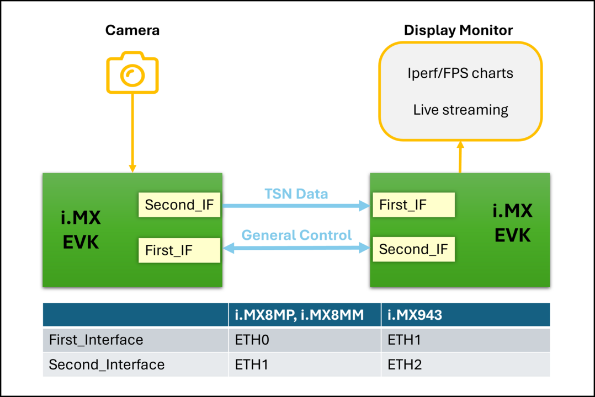

# GoPoint TSN Demo

NXP's *GoPoint for i.MX Applications Processors* unlocks a world of possibilities. This user-friendly app launches
pre-built applications packed with the Linux BSP, giving you hands-on experience with your i.MX SoC's capabilities.
Using the i.MX 8M Plus, i.MX 93 or i.MX943 EVKs you can run the included *TSN* application available on GoPoint
launcher as apart of the BSP flashed on to the board. For more information about GoPoint, please refer to
[GoPoint for i.MX Applications Processors User's Guide](https://www.nxp.com/IMXLINUX?_gl=1*gz87wm*_ga*ODQxOTk0OTQwLjE3MDQ5ODk3NzA.*_ga_WM5LE0KMSH*MTcwNDk4OTc2OS4xLjEuMTcwNDk4OTgyOS4wLjAuMA..).

## Demo Description

This demo showcases the Time-Sensitive Networking (TSN) capabilities of i.MX boards. In this setup, one board transmits data (video and text) to another board over the network. Using TSN features, the system can dynamically prioritize either video traffic or text traffic based on application requirements.

The board with the camera connected acts as the transmitter and controls the traffic priorities. The receiving board displays the incoming traffic, allowing you to visualize the effects of TSN traffic prioritization in real-time.

**Demo Diagram:**

  

## Steps to Run the Demo

1. **Check the connection setup and connect the ethernet cables** - Refer to the diagram above to verify the proper hardware configuration and network topology. Ensure all Ethernet cables are connected to match the interfaces shown in the setup diagram.

2. **Launch the application** - Start the TSN demo from the GoPoint launcher on your i.MX EVK board or from the command line launcher ($ **gopoint**).

>**Note:** If there is no display connected to the board, the demo will attempt to start in camera mode. Please verify this behavior with your specific hardware configuration.

